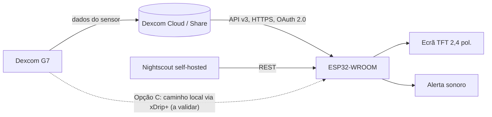

# Sinalizador de Diabetes — Análise de Mercado e Proposta Técnica/Design

**Data:** 3 de outubro de 2026
**Estado:** Proposta (fase de análise; implementação numa fase posterior)
**Âmbito:** análise de mercado e concorrência, arquitetura técnica, lógica de interface, design industrial e plano de implementação por fases para um ecrã de mesa de cabeceira que apresenta valores de glucose provenientes de um sensor Dexcom G7.

---

## 1. Resumo executivo

O Sinalizador de Diabetes é um ecrã dedicado de mesa de cabeceira que mostra, de forma imediata e legível à distância, o valor atual de glucose do utilizador. A apresentação resume-se a três elementos: um número grande, uma cor que indica a faixa glicémica e uma seta de tendência. Os valores chegam de um sensor Dexcom G7 através de um microcontrolador ESP32-WROOM ligado por Wi-Fi; a caixa é desenhada de raiz e impressa em 3D numa impressora Bambu Lab, com uma linguagem visual minimalista, super moderna e simples. O produto posiciona-se na lacuna entre as aplicações móveis (xDrip, aplicação oficial Dexcom), que exigem pegar no telemóvel, e os ecrãs dedicados comerciais (Glucose Display, $129.99 USD), que são caros e totalmente dependentes de internet. A proposta aposta em simplicidade, baixo custo, bom comportamento noturno e design industrial cuidado. O dispositivo é um acessório informativo: não é um dispositivo médico certificado e não substitui o sensor, a aplicação oficial, nem o acompanhamento médico.

---

## 2. Análise de mercado e concorrência

### 2.1 Soluções existentes

| Solução | Tipo | Preço / custo | Fontes de dados | Pontos fortes | Limitações |
|---|---|---|---|---|---|
| **Glucose Display** (glucosedisplay.com) | Ecrã dedicado comercial, 8" | $129.99 USD | Dexcom Share, LibreLinkUp, Nightscout | Número grande, gráficos históricos, bateria recarregável, produto acabado | Exige Wi-Fi e internet permanentes; preço elevado; formato grande para uma mesa de cabeceira |
| **McGeeLabs/sentinel-bg-monitor** (GitHub) | Projeto open-source DIY | Custo de componentes | Nightscout (REST) | ESP32 + PlatformIO; ecrã TFT ILI9488 3,5" (480×320); áudio I2S (MAX98357) para alertas de valores altos/baixos; setas de tendência | Em desenvolvimento (work in progress); sem caixa nem design industrial; exige montagem e configuração pelo utilizador |
| **M5Stack CGM / «M5 Scout»** (comunidade M5Stack; github.com/ctillier-vmware/BLocklyCGMforM5Stack) | DIY sobre hardware M5Stack | Custo de componentes | CGM conforme configuração da comunidade | Cor por faixa glicémica, delta, tempo desde a última atualização, seta de tendência, brilho ajustável; integração MQTT/Alexa | Relatos de utilizadores apontam problemas de brilho à noite («ecrã demasiado escuro para dormir», nas notas de investigação); hardware genérico sem caixa própria |
| **xDrip** | Aplicação móvel (G7, One+, Stelo) | Grátis / open-source | Ligação direta ao sensor | Solução de software madura e muito utilizada | Não é hardware dedicado: exige telemóvel, interação e o ecrã do telefone; não serve a leitura noturna imediata |

### 2.2 Leitura do mercado

Três conclusões diretas da investigação recolhida:

1. **Existe mercado pago para ecrãs dedicados.** O Glucose Display vende a $129.99 USD exatamente a promessa que queremos cumprir: um número grande e legível na mesa de cabeceira. O preço elevado e a dependência total de cloud abrem espaço para uma alternativa mais simples e barata.
2. **A viabilidade técnica está provada.** O Sentinel demonstra que um ESP32 com PlatformIO, a consumir Nightscout via REST, a mostrar setas de tendência e a disparar alertas sonoros, funciona. O M5 Scout demonstra o mesmo conceito noutro hardware e revela a falha que mais importa corrigir: o comportamento noturno.
3. **As aplicações móveis não resolvem o caso de uso noturno.** O xDrip e as aplicações oficiais vivem no telemóvel; de noite, o utilizador quer olhar para um ecrã fixo, sem desbloquear nada nem interagir com menus.

### 2.3 Lacuna identificada e posicionamento

Ecrã de cabeceira simples, de baixo custo, com leitura imediata (número, cor, seta), modo noturno bem calibrado, design moderno e, se se confirmar viável, um caminho de dados local para reduzir a dependência de cloud. Não competimos em quantidade de funcionalidades (ficam de fora gráficos históricos elaborados); competimos em experiência: olhar e perceber num segundo.

---

## 3. Arquitetura técnica

### 3.1 Fontes de dados: opções e compromissos

| Opção | Descrição | Prós | Contras |
|---|---|---|---|
| **A: Dexcom API v3 direta** | OAuth 2.0 com Bearer token; endpoints EGVs, devices e dataRange, com parâmetros `startDate`/`endDate` | Dados oficiais; sem servidor intermédio; estrutura de dados completa | Exige internet permanente; exige conta de programador; gestão e renovação periódica do token; sujeita a limites de taxa e a alterações da API |
| **B: Nightscout** | Instância self-hosted consumida via REST simples | API trivial de consumir no ESP32; comunidade madura; abordagem já validada pelo Sentinel | Mais um serviço para manter (ponto de falha adicional); continua a depender do upload dos dados do sensor para a cloud |
| **C: xDrip+ / caminho local** | Obter os valores localmente, sem depender de cloud | Menor latência potencial; independência de internet | Viabilidade por validar; exige investigação técnica antes de comprometer o desenho |

**Estratégia recomendada:** começar pela Opção A no protótipo, por ser o caminho mais direto para medir a latência real do sistema; manter a Opção B como alternativa madura e tratar a Opção C como investigação paralela. Se o caminho local se confirmar, passa a modo preferencial e a cloud fica como alternativa de recurso.

### 3.2 Componentes principais

- **Microcontrolador:** ESP32-WROOM. Wi-Fi integrado, custo baixo, ecossistema maduro (Arduino/PlatformIO, o mesmo stack do Sentinel).
- **Ecrã:** para o MVP recomenda-se um painel TFT de 2,4" (ILI9341) ou ST7789. Justificação: na mesa de cabeceira a distância de leitura é curta e o conteúdo é um número gigante com uma seta; um ecrã de 2,4" a 2,8" é suficiente, consome menos, é mais barato e permite uma caixa compacta. A alternativa maior (ILI9488 3,5", 480×320, usada no Sentinel) só se justifica se decidirmos apresentar gráfico histórico; fica registada como opção de evolução.
- **Alimentação:** USB como base. Um dispositivo de cabeceira vive junto à tomada; a alimentação por cabo elimina a gestão de carga, reduz o custo e simplifica a caixa. Bateria fica como refinamento da Fase 4.
- **Alerta sonoro:** buzzer simples ou, se se quiser áudio com mais controlo, o par I2S + MAX98357 já validado pelo Sentinel. Decisão na Fase 2.

### 3.3 Diagrama de blocos

Nota: no MVP o caminho ativo é cloud → ESP32. O caminho local (linha tracejada) é a frente de investigação da Opção C e não está garantido nesta fase.

---

## 4. Lógica de interface (o coração do produto)

### 4.1 Cores por faixa glicémica

Valores em mg/dL. Os limiares são configuráveis pelo utilizador; os valores por defeito seguem as faixas convencionais de tempo no alvo usadas neste tipo de produtos. Isto não constitui aconselhamento médico.

| Faixa (mg/dL) | Designação | Cor | Leitura pretendida |
|---|---|---|---|
| < 70 | Hipoglicemia | Vermelho | Situação prioritária; alerta sonoro |
| 70-90 | Baixa-marginal (opcional) | Laranja | Atenção; subfaixa configurável dentro do alvo |
| 70-180 | No alvo | Verde | Situação normal |
| 181-250 | Alta | Amarelo/laranja | Vigilância |
| > 250 | Muito alta | Vermelho | Situação prioritária; alerta sonoro |

Nota de implementação: se a faixa «baixa-marginal» estiver ativa, os valores 70-90 passam a laranja; caso contrário, todo o intervalo 70-180 apresenta verde. As cores têm de se manter distinguíveis com o brilho reduzido do modo noturno.

### 4.2 Seta de tendência

A tendência pode vir diretamente do campo de tendência da API (Opção A) ou ser derivada localmente a partir das N leituras mais recentes (taxa de variação em mg/dL/min). Limiares típicos, configuráveis:

| Seta | Significado | Limiar típico (mg/dL/min) |
|---|---|---|
| ↑↑ | Subida rápida | > +2 |
| ↑ | Subida | +1 a +2 |
| → | Estável | -1 a +1 |
| ↓ | Descida | -2 a -1 |
| ↓↓ | Descida rápida | < -2 |

Sempre que a API forneça a seta diretamente, usa-se o valor oficial; a derivação local serve o caminho Nightscout/local e funciona como validação cruzada.

### 4.3 Alertas e comportamento noturno

- **Alertas:** beep (ou vibração, se se incluir um motor) para hipoglicemia e hiperglicemia, com silenciamento temporário através do botão físico.
- **Modo noturno:** brilho reduzido, fundo escuro e paleta atenuada, com ativação automática por horário. Esta é a lição direta do M5 Scout: a gestão de brilho à noite foi o ponto mais criticado pelos utilizadores. O nosso produto trata o modo noturno como funcionalidade central, não como um extra.

### 4.4 Layout do ecrã

Ordem de prioridade visual:

1. **Número gigante** com o valor atual (mg/dL), centrado, ocupando a maior área do ecrã.
2. **Seta de tendência** ao lado do número, com dimensão suficiente para leitura à distância.
3. **Cor de fundo (ou do número)** a codificar a faixa glicémica.
4. **Idade da leitura** (ex.: «há 4 min») e, opcionalmente, o **delta** face à leitura anterior.
5. Indicador discreto do estado dos dados (ligação, atraso, ausência de dados).

Regra de ouro: se a leitura for mais antiga do que um limiar definido, o ecrã indica «sem dados recentes» em vez de apresentar um valor antigo como se fosse atual.

---

## 5. Design industrial / caixa 3D (Bambu Lab)

**Forma e ergonomia**

- Ecrã inclinado 15-30° face à vertical, para leitura natural a partir da cama.
- Base larga e estável, com centro de gravidade baixo.
- Dimensões alvo: ~100 × 70 × 60 mm (a ajustar ao ecrã final escolhido).
- Espessura de parede: 1,6-2 mm.

**Materiais e impressão**

- PLA para protótipos e iterações rápidas.
- PETG para a versão final: melhor resistência a impacto e a temperatura.
- Tolerâncias típicas de impressão FDM: folgas de 0,2-0,3 mm em encaixes, a validar com peças de teste na Bambu Lab antes do fecho do modelo.
- Orientação de impressão escolhida para minimizar suportes e deixar as faces visíveis com o melhor acabamento possível.

**Interface física e detalhes**

- Janela do ecrã embutida, sem moldura saliente.
- Um único botão opcional (silenciar alerta / confirmar leitura), embutido e de baixo perfil.
- Ventilação mínima: o ESP32 dissipa pouco; bastam ranhuras discretas na traseira.
- Saída traseira para o cabo USB, com alívio de tensão no cabo.

**Linguagem visual**

Super moderno e simples: superfícies contínuas, cantos suaves com raios generosos, acabamento mate, uma única cor de corpo, zero logótipos ruidosos. O objeto deve desaparecer no quarto durante o dia e comunicar com um relance durante a noite.

---

## 6. Plano de implementação por fases

| Fase | Conteúdo | Critério de saída |
|---|---|---|
| **1: Protótipo funcional** | ESP32 + ecrã; dados simulados e API Dexcom v3 real; medição de latência ponta a ponta | Valor atualizado no ecrã com latência medida e estável; renovação de token validada |
| **2: Alertas e noite** | Alertas sonoros de hipo e hiper; modo noturno; seta de tendência | Alertas disparam nas faixas corretas; ecrã noturno utilizável sem incomodar o sono |
| **3: Caixa 3D** | Modelação e impressão iterada na Bambu Lab (2-3 iterações) | Caixa fechada com encaixes corretos, botão funcional e acabamento pretendido |
| **4: Refinamento** | Bateria (opcional), atualizações OTA, calibração de cor do ecrã, investigação do caminho local (Opção C) | Decisão documentada sobre Opção A vs B vs C; produto pronto para uso diário prolongado |

---

## 7. Riscos e considerações

- **Latência da cloud vs necessidade clínica.** O valor apresentado acumula os atrasos sensor → cloud → API → dispositivo. Em eventos agudos (por exemplo, hipoglicemia em queda rápida), esse atraso pode ser clinicamente relevante. Mitigações: mostrar sempre a idade da leitura; os alarmes prioritários continuam a ser responsabilidade da aplicação oficial e do sensor.
- **Expiração do token Dexcom.** O acesso à API exige lógica de renovação e de tratamento de falhas. Regra de segurança: falha de autenticação ou de dados resulta na indicação explícita de «sem dados», nunca num valor antigo apresentado como atual.
- **Dependência e limites externos.** Limites de taxa e alterações na API Dexcom estão fora do nosso controlo; Nightscout atenua essa exposição, mas acrescenta um serviço para manter. A Opção C (caminho local) reduz estas dependências se se confirmar viável.
- **Sobreposição com aplicações oficiais.** O dispositivo coexiste com a aplicação oficial; não a substitui. Qualquer conflito de alarmes resolve-se em favor da aplicação oficial.
- **Aviso médico (disclaimer).** Este dispositivo não é um dispositivo médico certificado. É um acessório informativo de visualização. Não substitui o sensor Dexcom, a aplicação oficial, os alarmes oficiais, nem o acompanhamento médico. Nenhuma decisão clínica deve ser tomada com base apenas neste ecrã.

---

## 8. Conclusão e próximos passos

A investigação sustenta o produto em três frentes: existe mercado pago por esta promessa (Glucose Display a $129.99 USD); existe prova técnica de que o stack ESP32 + Nightscout + ecrã TFT funciona (Sentinel); e existe uma falha de experiência identificada que podemos transformar em vantagem (brilho noturno, caso M5 Scout). A diferença do nosso produto não está em mais funcionalidades; está na execução simples, barata e bem desenhada do essencial.

Próximos passos recomendados:

1. Criar conta de programador Dexcom e validar o fluxo OAuth 2.0 e os endpoints EGVs com dados reais.
2. Encomendar o hardware do MVP: ESP32-WROOM e ecrã ST7789/ILI9341 de 2,4".
3. Construir o protótipo da Fase 1 com dados simulados e, de seguida, com a API real; medir e registar a latência ponta a ponta.
4. Em paralelo, investigar a Opção C (xDrip+/caminho local) com uma prova de conceito mínima.
5. Iniciar os primeiros modelos da caixa assim que o ecrã estiver escolhido, imprimindo peças de teste de encaixe na Bambu Lab.

---

*Documento de análise e proposta técnica. Nenhum conteúdo deste documento constitui aconselhamento médico.*
