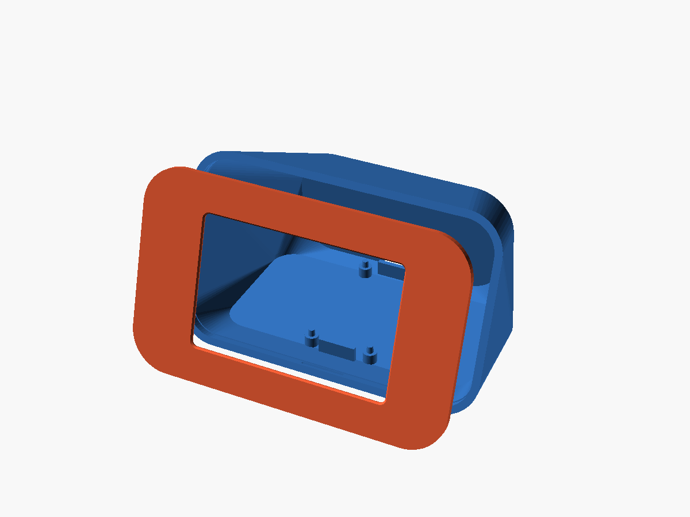
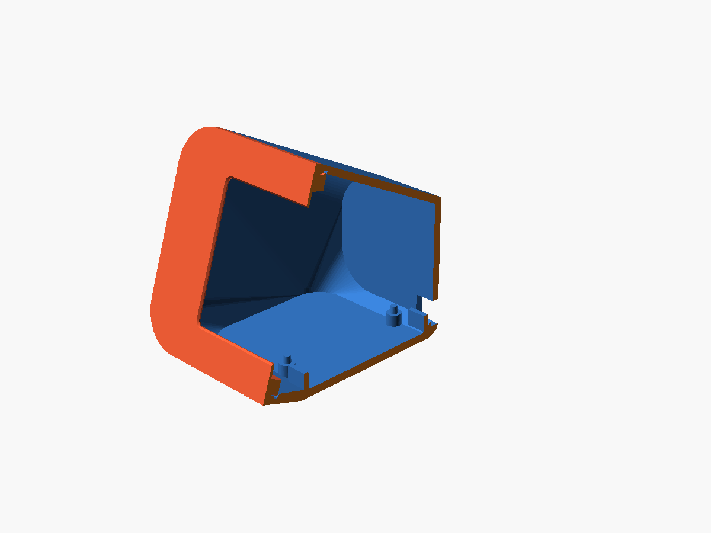
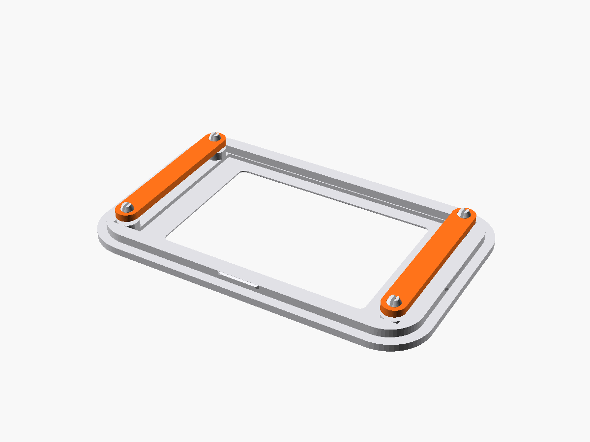
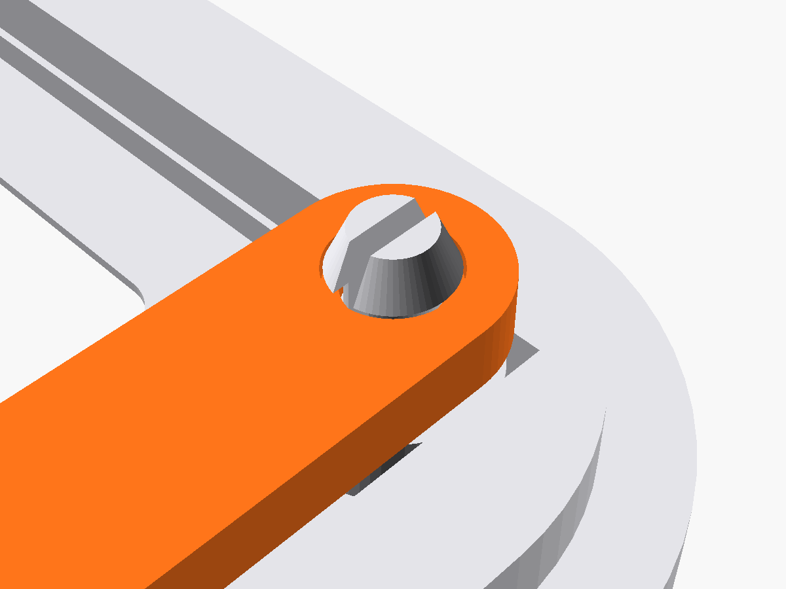
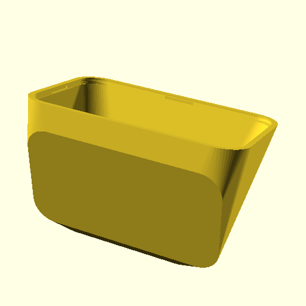
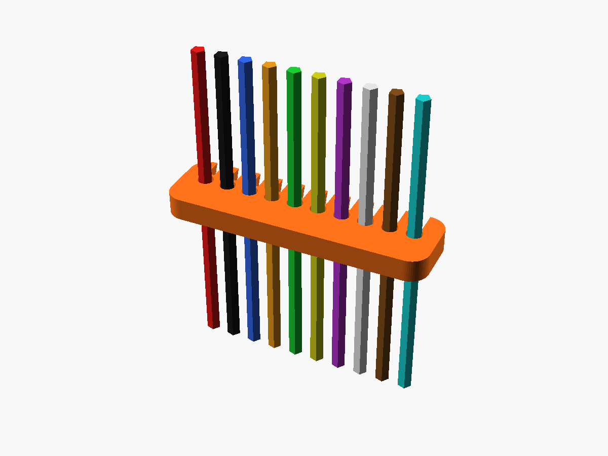

# 🩸 GLICOMETER — Monitor Bedside de Glucose & Relógio Inteligente

[](LICENSE)
[](https://www.espressif.com/)
[](#-lista-de-materiais-bill-of-materials---bom--custos)
[](#-engenharia-do-modelo-3d-design-híbrido-pla--petg)
[](https://openaps.org/)

> **⚠️ AVISO IMPORTANTE**: Este é um **acessório informativo open-source para cabeceira**, desenvolvido pela comunidade diabetes (#WeAreNotWaiting). **NÃO é um dispositivo médico certificado.** Confirme sempre as leituras na aplicação oficial ou receptor prescrito antes de qualquer decisão terapêutica.

---

## 🌟 Visão Geral & Conceito

O **GLICOMETER** é um dispositivo de cabeceira (*bedside companion*) concebido para dar tranquilidade dia e noite a pessoas com diabetes tipo 1 e tipo 2, bem como aos seus cuidadores. 

Ligado via Wi-Fi ao sensor de glicose contínua (**Dexcom G7 / Nightscout / FreeStyle Libre**), apresenta os dados de glicemia em tempo real com números gigantes, cores indicadoras de zona (verde, amarelo, vermelho), setas de tendência e alerta sonoro/luminoso inteligente, alternando com relógio sincronizado por NTP e meteorologia local automática.

```
       ┌────────────────────────────────────────────────────────┐
       │                  GLICOMETER BEDSIDE                    │
       │                                                        │
       │   [ 118 ] mg/dL  →  Glicemia em tempo real             │
       │     ↗ +3 mg/dL   →  Tendência e delta (5 min)          │
       │   Fundo Verde    →  Zona Alvo (70-180 mg/dL)           │
       │   07:42 | 19°C   →  Relógio NTP + Tempo (Open-Meteo)   │
       └────────────────────────────────────────────────────────┘
```

---

## 📐 Engenharia do Modelo 3D (Design Híbrido PLA + PETG)

A carcaça foi integralmente redesenhada em **OpenSCAD** para aliar tolerâncias mecânicas precisas, estética de produto comercial e montagem **100% livre de parafusos**.



### 1. Sistema Snap-Fit com Travamento Positivo (Zero Parafusos)
* **Moldura na Caixa**: A moldura possui **4 dentes de retenção cónicos a 45°** na aba macho perimetral. Ao ser pressionada contra o corpo, encaixa com um **CLIQUE mecânico firme** dentro das 4 ranhuras fêmea correspondentes. A moldura fica permanentemente bloqueada — **não cai, não treme e não tem folgas**.
* **Corte Transversal**: O contorno exterior fica perfeitamente nivelado e contínuo a 360°, sem ranhuras nem parafusos exteriores visíveis.



### 2. Pinos Snap Fendidos (*Split-Barb*) para Retenção do Ecrã
* Em vez de anéis frágeis ou parafusos roscados, os 4 postes da moldura integram **pinos com fenda elástica central de 0.85 mm** e cabeça cónica com ombro plano a 90°.
* Ao pressionar as barras de retenção, as duas metades do pino fecham suavemente pelo furo e **expandem com força**, bloqueando as barras no rebaixo superior.




### 3. Estratégia de Materiais Híbrida:
| Componente | Material Recomendado | Motivo de Engenharia |
|---|---|---|
| **Moldura Frontal** | **PLA** | Máxima rigidez, estabilidade dimensional e acabamento estético impecável encostado à mesa PEI. |
| **Corpo (Caixa)** | **PLA** | Excelente acabamento de camadas e paredes exteriores 100% sólidas. |
| **Clips de Retenção do LCD** | **PETG** | Elasticidade superior, memória de forma e resiliência a ciclos mecânicos sem quebrar. |
| **Organizador de Cabos** | **PETG** | Flexibilidade nas ranhuras elásticas para encaixar e prender os fios com firmeza. |

---

## 🖨️ Ficheiros STL & Parâmetros de Impressão 3D

Todos os ficheiros estão otimizados para imprimir **sem suportes (*Support = OFF*)**:

| Ficheiro STL | Orientação na Mesa | Material | Tempo Est. | Suportes |
|---|---|---|---|---|
| [`modelo-3d/stl/corpo_glicometer.stl`](modelo-3d/stl/corpo_glicometer.stl) | Deitado de costas ($Z=0$ na traseira) | PLA | ~1h 45m | **DESLIGADO (OFF)** |
| [`modelo-3d/stl/moldura_frontal.stl`](modelo-3d/stl/moldura_frontal.stl) | Deitada com a face lisa na mesa PEI | PLA | ~45m | **DESLIGADO (OFF)** |
| [`modelo-3d/stl/clips_retencao_lcd.stl`](modelo-3d/stl/clips_retencao_lcd.stl) | Deitado horizontal | PETG | ~3m | **DESLIGADO (OFF)** |
| [`modelo-3d/stl/organizador_cabos.stl`](modelo-3d/stl/organizador_cabos.stl) | Deitado horizontal | PETG | ~2m | **DESLIGADO (OFF)** |



### Definições Recomendadas no Fatiador (Bambu Studio / OrcaSlicer / PrusaSlicer):
* **Altura de Camada**: `0.20 mm` (Standard)
* **Paredes / Perímetros**: `3 a 4 voltas` (mínimo $1.2\text{ mm}$ para estanqueidade mecânica)
* **Preenchimento (Infill)**: `15% a 20%` (Gyroid ou Grid)
* **Suportes**: `Desativados (None / OFF)` em todas as peças.

---

## 🔌 Pente Organizador de Cabos (Cable Management)

Para evitar que os fios DuPont fiquem soltos ou sejam trilhados durante o fecho da moldura, o projeto inclui um **Pente Organizador de Cabos elástico em PETG**:



* **10 Ranhuras Snap**: Cada fio DuPont ($\sim 1.4\text{ mm}$) entra com uma ligeira pressão na ranhura chanfrada e fica retido na sua cavidade.
* **Fita Plana Flexível**: Transforma o ninho de fios num cabo plano flexível que se dobra suavemente em "S" no interior da caixa.

---

## 📋 Lista de Materiais (Bill of Materials - BOM) & Custos

### 1. Eletrónica & Cablagem

| Item | Componente | Ref. / Modelo | Qtd | Custo Médio (€) | Fornecedor |
|:---:|---|---|:---:|:---:|---|
| 1 | **Microcontrolador** | ESP32-WROOM-32 DevKit (30 pinos) | 1 | 4,50 € – 6,50 € | AliExpress / Amazon / Loja Local |
| 2 | **Ecrã TFT 3.5" SPI** | MSP3520 (KMRTM35018-SPI) 480×320 ILI9488 | 1 | 9,50 € – 12,00 € | AliExpress / Amazon |
| 3 | **Buzzer Piezo** | Passivo 5V / 3.3V (Tone PWM) | 1 | 0,50 € – 0,80 € | AliExpress / Kits |
| 4 | **Botão Momentâneo** | Micro Push Button 6×6 mm (Silêncio / Noite) | 2 | 0,40 € | Kits Eletrónica |
| 5 | **Fios de Ligação** | Cabos Jumper DuPont Fêmea-Fêmea 10 cm | 10–12 | 0,60 € | Kits |
| 6 | **Cabo de Alimentação** | Cabo USB-A para Micro-USB ou Type-C | 1 | 1,50 € | Existente em casa |
| 7 | **Fonte de Alimentação**| Carregador USB 5V $\ge 1\text{A}$ | 1 | 3,00 € – 4,50 € | Existente em casa |

### 2. Impressão 3D (Consumo de Filamento)

| Item | Peça | Material | Peso Est. | Custo Est. (€) |
|:---:|---|---|:---:|:---:|
| 1 | Corpo do Glicometer | PLA | ~48 g | ~1,00 € |
| 2 | Moldura Frontal | PLA | ~18 g | ~0,40 € |
| 3 | Clips de Retenção (2x) | PETG | ~3 g | ~0,08 € |
| 4 | Organizador de Cabos | PETG | ~2 g | ~0,05 € |

### 💰 Resumo Financeiro:
* **Total em Hardware & Filamento**: **~22 € a 28 €** (utilizando carregador e cabo existentes).
* **Comparação de Mercado**: Dispositivos comerciais semelhantes custam entre **$120 e $150 USD**.

---

## ⚡ Esquema de Ligações (Pinout ESP32 ↔ MSP3520)

| Ecrã MSP3520 (KMRTM35018) | ESP32 GPIO (DevKit 30 Pinos) | Função |
|---|---|---|
| **VCC** | **VIN (5V) ou 3V3** | Alimentação positiva |
| **GND** | **GND** | Massa |
| **CS** | **GPIO 15** | Chip Select TFT |
| **RESET** | **GPIO 4** | Reset do Display |
| **DC / RS** | **GPIO 2** | Data / Command |
| **SDI (MOSI)** | **GPIO 23** | SPI Master Out Slave In |
| **SCK (CLK)** | **GPIO 18** | SPI Clock |
| **LED** | **GPIO 32** | Controlo de Brilho (PWM Dia/Noite) |
| **SDO (MISO)** | **GPIO 19** *(Opcional)* | SPI MISO |
| *Buzzer (+)* | **GPIO 27** | Alertas sonoros de Hipo/Hiper |
| *Botão MUTE* | **GPIO 13** *(para GND)* | Silenciar alertas (INPUT_PULLUP) |
| *Botão NIGHT* | **GPIO 14** *(para GND)* | Dimming noturno (INPUT_PULLUP) |

---

## 🛠️ Guia Passo-a-Passo de Montagem

1. **Impressão 3D**:
   * Imprima o corpo e a moldura em **PLA**.
   * Imprima os clips e o pente organizador em **PETG**.
2. **Instalação do Ecrã na Moldura**:
   * Pouse a moldura com a face da frente voltada para baixo numa superfície macia.
   * Encaixe o ecrã MSP3520 no berço traseiro da moldura, alinhando os 4 furos do PCB com os 4 pinos fendidos da moldura.
   * Deslize os 2 clips de PETG sobre os pinos até ouvir o **CLIQUE** de travamento. O ecrã fica firmemente prensado.
3. **Cablagem & Organização**:
   * Ligue os fios DuPont aos pinos do ecrã.
   * Encaixe os fios nas ranhuras do **Pente Organizador**, formando a fita plana de cabos.
   * Ligue as outras extremidades dos fios aos respetivos pinos do ESP32.
4. **Instalação do ESP32 no Corpo**:
   * Encaixe o ESP32 nos 4 pinos do piso interior do corpo, alinhando a porta USB com o rasgo traseiro da caixa.
5. **Fecho Final (Snap-Fit)**:
   * Conduza a fita de cabos para fazer uma curva suave no centro da caixa.
   * Alinhe a moldura com o degrau fêmea do corpo e pressione firmemente nas 4 bordas até ouvir o travamento do *snap-fit*.

---

## 💻 Configuração do Firmware (PlatformIO)

O firmware é desenvolvido em C++ com suporte para FreeRTOS, TFT_eSPI e Dexcom API / Nightscout:

```bash
# 1. Clonar o repositório
git clone https://github.com/seu-utilizador/GLICOMETER.git
cd GLICOMETER/firmware

# 2. Configurar credenciais em src/config.h
# Definir WIFI_SSID, WIFI_PASS, DEXCOM_CLIENT_ID e DEXCOM_REFRESH_TOKEN

# 3. Compilar e gravar no ESP32 via USB
pio run -t upload
```

---

## 📜 Licença & Créditos

Projeto distribuído sob a licença **MIT**.
Criado com dedicação pela comunidade diabetes (#WeAreNotWaiting).
Não afiliado nem patrocinado pela Dexcom, Abbott ou Medtronic.